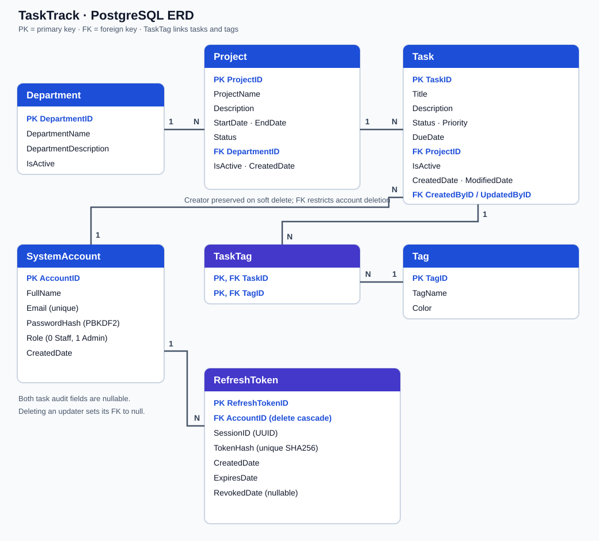

# TaskTrack API · PRN232 Assignment 2

ASP.NET Core 8 Web API with public business reads and Staff/Admin management. The solution has three projects: `TaskTrack.API` for HTTP endpoints, `TaskTrack.Service` for business rules, and `TaskTrack.Repo` for EF Core database access.

## Database ERD

Assignment 2 reuses the existing PostgreSQL database on Render. Back it up before extending its schema with SQL updates. Do not rerun the supplied `TaskManagementDB_Postgres (1).sql` initialization script: it starts with DROP TABLE statements. `TaskTag` links tasks and tags. `SystemAccount` stores PBKDF2 password hashes and owns hashed refresh tokens. `Task.CreatedByID` remains nullable for legacy data and restricts deletion of creator accounts.

## Run locally

1. Use the existing PostgreSQL database and preserve its data. Back it up before applying Assignment 2 schema updates; do not rerun the initialization script.
2. Apply `database/001_assignment2_schema.sql`, `database/003_task_update_audit.sql` and `database/004_deletion_history.sql` after backup. Set `ConnectionStrings__DefaultConnection` or `DATABASE_URL` and a `JWT_SECRET` of at least 32 UTF-8 bytes in your environment (or local ASP.NET Core user secrets). Keep real credentials out of Git.
3. Set `FRONTEND_URL` to the allowed frontend origin, without a trailing slash. It defaults to `http://localhost:3000` for local development.
4. From the repository root, run `dotnet restore` and `dotnet run --project TaskTrack.API --launch-profile http`.

Swagger is available locally at `http://localhost:5117/swagger`. This project has its own user secrets ID; configure its database connection separately.

## Deployment

The [live API and Swagger](https://qe190117-se19b-ass2-be.onrender.com/swagger) run as a separate free Docker service in Render's **PRN232 / Production** environment. The [frontend](https://qe190117-se19b-ass2-fe.vercel.app) is a separate Vercel project. Git pushes to `main` deploy automatically.

Configure `DATABASE_URL`, a separate production `JWT_SECRET`, `ASPNETCORE_ENVIRONMENT=Production` and `FRONTEND_URL=https://qe190117-se19b-ass2-fe.vercel.app` on Render. Never commit secrets. Seed the grading Admin directly with `database/002_seed_admin.sql`, supplying psql variables and a hash generated by this application's IdentityV3 PBKDF2 hasher. The script does not overwrite an existing email. Create the grading Staff through the live register page. Credentials belong only in the submission document.

Free services can take time to wake after inactivity. The reused free PostgreSQL instance currently expires on **26 October 2026**; preserve a backup and extend its availability before grading after that date.

## API behavior

- `GET /api/health` is public and uncached. It probes the database with a three-second cancellation budget, returning 200 with `status: healthy`, `database: reachable` and a UTC `checkedAt`, or 503 with generic unhealthy/unavailable fields. It never returns connection strings or exception details. Call [production health](https://qe190117-se19b-ass2-be.onrender.com/api/health) before a demo; the first call may wake the free service. This does not extend the database expiry or guarantee continuous availability.
- All business GET endpoints and search remain public. POST, PUT and DELETE require Staff (role 0) or Admin (role 1).
- Department/project deletion is rejected when child records exist; tag deletion is rejected while any task uses the tag.
- Task DELETE sets `IsActive` to false and preserves `CreatedByID`. Task creation takes its creator from the authenticated JWT, ignoring client input.
- Successful deletions of departments, projects, tasks, tags and eligible accounts atomically create deletion history. `GET /api/deletions` supports resource, state, name search and pagination; `POST /api/deletions/{id}/restore` restores the original ID within exactly 24 hours. Staff can view/restore the four business groups; only Admin can view/restore accounts. History starts at feature activation. Expired and restored metadata stay visible; existing linked-record restrictions remain in force.
- Restore rejects expired or already restored entries, missing/inactive parents and duplicate names/emails with 409. Restore parents first. Database row locks allow only one concurrent winner, and the deadline is rechecked after lock waits. Private snapshots are never returned by the API and are cleared after successful restoration. Account restoration preserves the previous password and role but cannot revive revoked sessions; fresh login is required. Deleted account IDs remain in history as audit references.
- Task PUT and DELETE record `UpdatedByID` from the authenticated account. Detail responses expose both audit IDs; legacy values remain null. Deleting a non-creator updater clears its audit link, while the creator restriction remains enforced.
- Register creates only Staff and hashes passwords with PBKDF2. Login issues 15-minute access tokens and stores only hashes of 7-day refresh tokens.
- `POST /api/auth/refresh` atomically rotates a refresh token; replay revokes its entire session. Rotation retains the original 7-day deadline. `POST /api/auth/logout` revokes that session and is idempotent. Both accept `{ "refreshToken": "..." }` so logout also works when an access token has expired.
- `GET /api/auth/me` returns the current account. All `/api/accounts` endpoints require Admin. Account deletion returns 409 if the account created any task, including a soft-deleted task.
- Role changes revoke the account's sessions. JWT authentication checks the live account, current role and active session, so deleted accounts and revoked privileges cannot keep using old tokens.
- `PUT /api/auth/profile` updates only the caller's full name. `PUT /api/auth/password` verifies the current password, stores a new PBKDF2 hash and atomically revokes all sessions. A concurrent login verified against the old hash cannot start a session after the change; concurrent password changes have one winner.
- CORS allows the origin configured by `FRONTEND_URL`, or the local frontend by default.

See [tests/README.md](tests/README.md) for HTTP/database regression checks. GitHub Actions builds the API and regression runner on every push; live integration checks run separately with a configured database.

The pre-bonus backup was restored into an isolated PostgreSQL 18 database, compared with live business/account data, and used to verify the audit migration twice before production application. Backup files and credentials remain outside Git.
